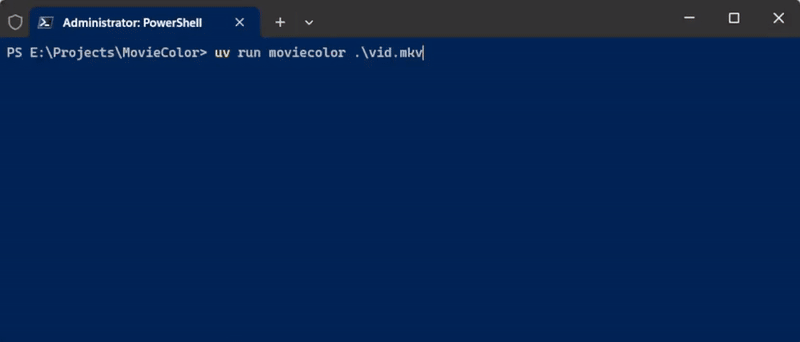

# MovieColor

Create a "MovieBarcode" using average color of each frame as bars:

***Example: John Wick Movie***


or using shrinked frames as bars (with `--alt` argument):


## Installation:

Install with [uv](https://docs.astral.sh/uv/):
```
uv tool install moviecolor
```
Or clone the project and use `uv run moviecolor`.

*\* Make sure you have [ffmpeg](https://www.ffmpeg.org/) installed.*

## Usage:

Run it with:
```
moviecolor input.mp4 [--alt] [--help]
```

or without installing:
```
uvx moviecolor input.mp4 [--alt] [--help]
```

>-a , --alt: instead of using average color, use shrinked frames


